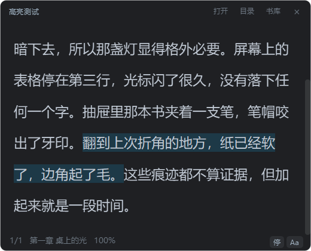

# 行间 Interline

> 一个贴在工作界面上的中文电子书阅读器。半透明、置顶、可以缩成一行，随时一键消失。


---

## 为什么有这东西

市面上的阅读器都在抢你的整个屏幕：全屏、翻页动画、书架、云同步、埋点。

但真实场景经常是另一回事——你在等一个构建、等一个回包、等一个会议开始，手边有十分钟，想读两页书，同时不想让人一眼看出你在看书。

所以这个项目只做几件事：窗口小、能置顶、能透明、能压成一行动态栏、一个键就没了。剩下的都往后排。

<p align="center">
  
</p>

## 功能

**窗口**

- 无边框、圆角自绘面板，右上角可拖动，右下角可缩放
- 始终置顶（可关），整窗透明度 0.15–1.0，底板不透明度单独可调——文字保持清晰，只有背景变透
- 四套皮肤：墨蓝 / 纯黑 / 暖褐 / 纸白，`F10` 轮换
- 字号 10–40 px（滑动条上写多少，屏幕上就是多少像素）、行距、字体族都能调
- 托盘常驻，点 × 只是收起窗口，退出走托盘菜单；重复启动只把已有窗口叫到前面，不会开出第二个

<p align="center">
  
</p>

**一行模式（`F9`）**

把整个窗口压成一条，只显示当前这句话，宽度按字数自适应。顶部 8px 窄条拖动位置，点正文翻下一句。

<p align="center">
  
</p>

**老板键（`Ctrl+Alt+D`）**

走 Win32 `RegisterHotKey`，焦点在任何窗口都能用。键位被别的程序占用时会自动换成候选键，并在设置页标出实际生效的组合。

**听书**

Qt TextToSpeech 的 `winrt` 后端，系统自带音色，不需要联网也不需要额外的语音包。按句朗读、读到哪句高亮哪句，选中一段可以直接「从这里开始读」。语速音量可调，进度按句记住。

<p align="center">
  
</p>

**书库与标注**

- 书库支持卡片/列表两种视图，显示全书进度（章 + 百分比），文件丢了会标灰
- 目录、全书搜索（带命中计数和上下跳转）
- 书签、正文高亮，标注面板里 `Enter` 跳转、`Del` 删除
- 删书带撤销——连标注一起删掉也能恢复

<p align="center">
  
  
</p>

**格式**

| 格式 | 说明 |
| --- | --- |
| `.txt` `.md` `.text` `.log` / 无扩展名 | 自动识别 UTF-8 / GB18030，按 `第X章` `Chapter N` `序章` `番外` 等切章；没有章节标记的按 2 万字分块 |
| `.epub` | zipfile + ElementTree 直接读 spine 顺序，不依赖第三方解析库 |
| `.html` `.htm` `.xhtml` | 去标签后按文本处理 |
| `.pdf` | pdfminer 按版面坐标取文本，用「首行缩进」断段而不是靠行尾标点 |

单章超过 6 万字会自动再切，避免单个富文本文档大到滚动发涩。

## 下载即用

如果 [Releases](/releases) 里有现成的 `Interline.exe`，直接下下来双击就行。没有的话，按下面的「打包」自己生成一个，逻辑一样。

单文件绿色版，不写注册表、不加启动项、不生成日志。

数据默认在 `%LOCALAPPDATA%\Interline\`：

```
config.json    窗口位置、字体、皮肤、快捷键、朗读设置
library.json   书库与阅读进度
marks.json     书签与高亮
```

想带着走就把 exe 放到 U 盘，启动时加 `--portable`，数据改存到 exe 同级的 `InterlineData\`。

## 快捷键

| 操作 | 默认键 | | 操作 | 默认键 |
| --- | --- | --- | --- | --- |
| 下一页 | `Space` | | 添加书签 | `Ctrl+D` |
| 上一页 | `Shift+Space` | | 高亮选中 | `Ctrl+H` |
| 下一章 | `→` | | 目录 | `Ctrl+T` |
| 上一章 | `←` | | 搜索 | `Ctrl+F` |
| 朗读开关 | `F5` | | 书库 | `Ctrl+L` |
| 一行模式 | `F9` | | 设置 | `Ctrl+,` |
| 切换皮肤 | `F10` | | 老板键（全局） | `Ctrl+Alt+D` |
| 语速 −/+ | `[` `]` | | | |

全部可以在设置里改，按下新组合键即时生效，清空则恢复默认。

<p align="center">
  
</p>

## 代码在哪

纯 Python，约 4800 行，除了 PyQt6 只有一个 pdfminer 依赖。

| 文件 | 负责 |
| --- | --- |
| `main.py` | 窗口、背景自绘、翻页与渲染主流程、听书、交互 |
| `book_parser.py` | TXT / EPUB / HTML / PDF 解析与切章 |
| `library_view.py` | 书库卡片/列表视图、目录与书签面板 |
| `settings_dialog.py` | 设置窗口（外观 / 快捷键 / 朗读 / 关于） |
| `store.py` | 三个 JSON 的读写、默认值合并、旧版字号迁移 |
| `theme.py` | 皮肤定义与浅色底下的颜色派生 |
| `tts.py` | 逐句朗读队列与逐词高亮回调 |
| `hotkey.py` | Win32 全局热键注册与原生事件过滤 |
| `logo.py` `make_icon.py` | 托盘/窗口图标绘制，生成 `icon.ico` |
| `Interline.spec` | PyInstaller 打包配置 |

## 从源码跑

```bash
pip install -r requirements.txt
python main.py                 # 正常启动
python main.py --selftest      # 检查 Qt / 解析层 / TTS 引擎是否可用
python main.py --pdfcheck a.pdf # 只跑 PDF 解析，把结果打到临时文件
```

调试时想避免污染真实配置，用环境变量把数据目录指到别处：

```bash
set INTERLINE_DATA_DIR=D:\tmp\interline
```

## 打包

```bash
pip install pyinstaller
python -m PyInstaller Interline.spec --noconfirm
```

产物是 `dist/Interline.exe`，约 60 MB。spec 里刻意没开 UPX：单文件包本身已 deflate，UPX 净收益约 10%，但会让每次启动多一层解压、更容易被杀软误报。同时剔掉了 ffmpeg 解码后端和 `opengl32sw.dll`（合计约 35 MB），它们对纯文字阅读没有用处。

版本号只有一个来源：`main.py` 里的 `BUILD_VERSION`，打包时由 spec 写进 exe 产品版本，运行时从 exe 属性读回来。

## 已知限制

- **只有 Windows。** 老板键走 Win32 `RegisterHotKey`，朗读默认用 `winrt` 后端，这两处在别的系统上都跑不起来。
- **文件改名或移动后，书签和高亮会失联。** 书的 id 是路径的 hash，有意为之（同一本书换个盘符就该当新书）。想支持「重新定位」得连带迁移 `marks` 记录。
- **PDF 是重排文本，不是原版版式。** 表格、多栏、图文混排的 PDF 效果会很差，扫描件更不行（没有 OCR）。
- **一行模式只跟着句子走**，适合偷看两眼，不适合整章速读。
- **没有云同步、没有导出、没有加密。** 这些都在「明确不做」的清单里。

## License

[MIT](LICENSE)
