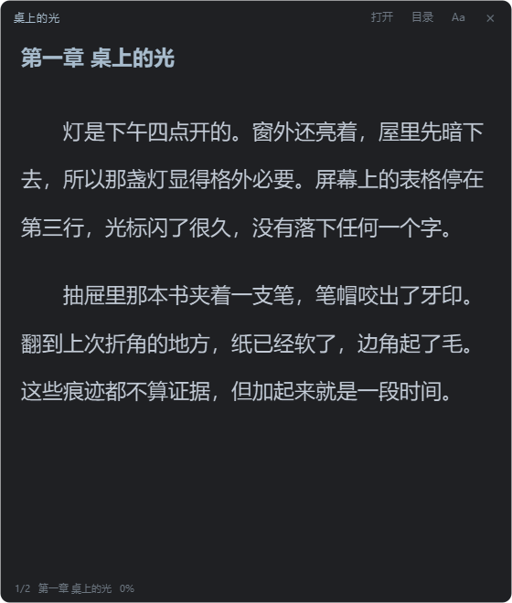
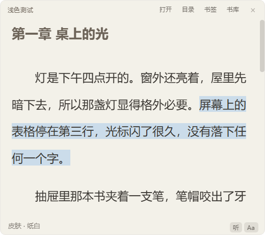
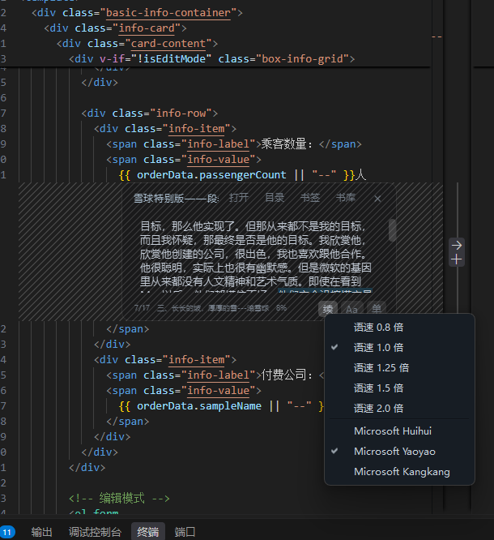
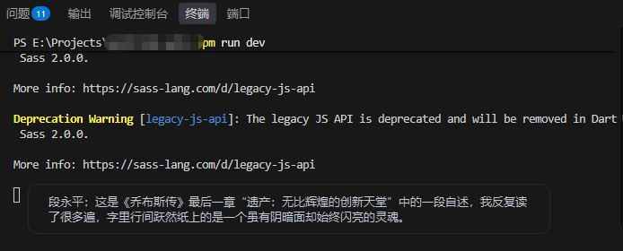
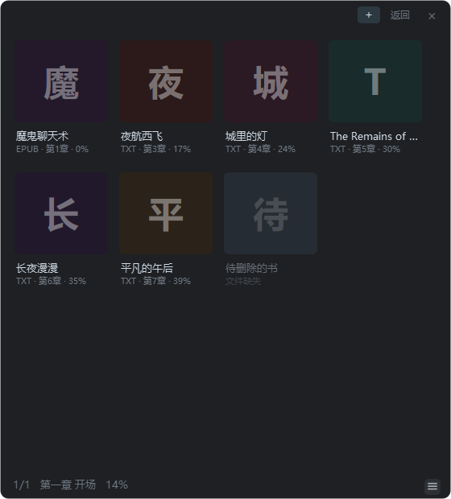
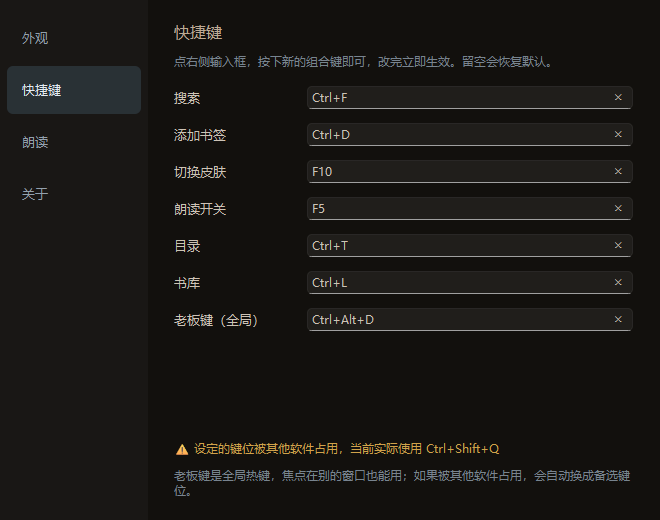

# 行间 Interline

> 贴在别的窗口上的中文电子书阅读器。半透明、置顶，能压成一条，一键就没。


---

## 为什么有这东西

主流的阅读器都想占满屏幕，书架、翻页动画、云同步、使用统计一样不少。但我打开阅读器的场合通常很窄：等构建、等回包、等会议开始，手边十分钟，读两页，不想让人看出来。

所以它只照顾这一种用法。一个不占地方的小窗口，浮在别的程序上面，透到能看见底下的代码，读完了按一下就没了。

<p align="center">
  
</p>

## 功能

**窗口**

- 无边框圆角面板，拖顶栏移动，右下角拉大小
- 默认置顶，可以关掉。整窗透明度 0.15–1.0；底板透明度是另外一项，只让背景变透，字始终是实的
- 四套皮肤：墨蓝、纯黑、暖褐、纸白，`F10` 轮换
- 字号 10–40 px，滑动条写多少屏幕上就是多少像素。行距和字体族也能调
- 常驻托盘。点 × 只是收起来，退出在托盘菜单里。重复启动不会开第二个窗口，只会把已有的叫到前面

<p align="center">
  
</p>

**一行模式（`F9`）**

整个窗口压成一条，只显示当前这句，宽度跟着字数走。顶部 8px 的窄边用来拖位置，正文区点一下就翻下一句，方向键和滚轮也行。

<p align="center">
  
</p>

**老板键（`Ctrl+Alt+D`）**

走 Win32 的 `RegisterHotKey`，焦点在别的程序里也能按。键位被占用会自动换候选，设置页标出实际生效的那个。小键盘上的符号键同样有效。

**听书**

Qt TextToSpeech 的 `winrt` 后端，用系统自带音色，离线可用，不用另装语音包。按句读，读到哪句高亮哪句；选中一段可以直接「从这里开始读」。语速和音色在「听」按钮的右键菜单里调，语速五档（0.8 倍到 2.0 倍），音色从系统已安装的语音里挑。进度精确到句。

<p align="center">
  
</p>

<p align="center">
  
</p>

**书库与标注**

- 卡片、列表两种视图，显示全书进度（章 + 百分比）。文件不在了会标灰
- 目录、全书搜索，带命中数和上下跳转
- 全书书签。标注面板里 `Enter` 跳转，`Del` 删除
- 删书能撤销，书签一起回来

<p align="center">
  
  
</p>

**格式**

| 格式 | 说明 |
| --- | --- |
| `.txt` `.md` `.text` `.log` / 无扩展名 | 自动识别 UTF-8 / GB18030，按 `第X章` `Chapter N` `序章` `番外` 等切章；没有章节标记的按 2 万字分块 |
| `.epub` | zipfile + ElementTree 直接读 spine 顺序，不依赖第三方解析库 |
| `.html` `.htm` `.xhtml` | 去标签后按文本处理 |
| `.pdf` | pdfminer 按版面坐标取文本，用「首行缩进」断段而不是靠行尾标点 |

单章超过 6 万字会自动再切，免得单个富文本文档大到滚动发涩。

## 下载即用

如果 [Releases](/releases) 里有现成的 `Interline.exe`，下下来双击就能用。没有的话按下面「打包」自己生成，跑起来是一样的。

单文件绿色版，双击就跑。注册表和启动项都不碰，退出后也不留日志文件。

数据在 `%LOCALAPPDATA%\Interline\`：

```
config.json    窗口位置、字体、皮肤、快捷键、朗读设置
library.json   书库与阅读进度
marks.json     书签
```

想带着走就把 exe 放 U 盘，启动时加 `--portable`，数据改存到 exe 同级的 `InterlineData\`。

## 快捷键

| 操作 | 默认键 | | 操作 | 默认键 |
| --- | --- | --- | --- | --- |
| 滚动一屏 | `Space` | | 添加书签 | `Ctrl+D` |
| 向上滚一屏 | `Shift+Space` | | 目录 | `Ctrl+T` |
| 朗读开关 | `F5` | | 搜索 | `Ctrl+F` |
| 一行模式 | `F9` | | 书库 | `Ctrl+L` |
| 切换皮肤 | `F10` | | 老板键（全局） | `Ctrl+Alt+D` |

头两项是正文区自带的滚动，改不了。其余七项可以在设置里改（右键菜单 → 设置…），按下新组合键即时生效，清空则恢复默认。切换章节走目录，或者把正文滚到底。

<p align="center">
  
</p>

## 代码在哪

纯 Python，约 4900 行，除了 PyQt6 只有 pdfminer 一个依赖。

| 文件 | 负责 |
| --- | --- |
| `main.py` | 窗口、背景自绘、翻页与渲染主流程、听书、交互 |
| `book_parser.py` | TXT / EPUB / HTML / PDF 解析与切章 |
| `library_view.py` | 书库卡片/列表视图、目录与书签面板 |
| `settings_dialog.py` | 设置窗口（外观 / 快捷键 / 朗读 / 关于） |
| `store.py` | 三个 JSON 的读写、默认值合并、旧版字号迁移 |
| `theme.py` | 皮肤定义与浅色底下的颜色派生 |
| `tts.py` | 逐句朗读队列与逐词高亮回调 |
| `hotkey.py` | Win32 全局热键注册与原生事件过滤 |
| `logo.py` `make_icon.py` | 托盘/窗口图标绘制，生成 `icon.ico` |
| `Interline.spec` | PyInstaller 打包配置 |

## 从源码跑

```bash
pip install -r requirements.txt
python main.py                 # 正常启动
python main.py --selftest      # 检查 Qt / 解析层 / TTS 引擎是否可用
python main.py --pdfcheck a.pdf # 只跑 PDF 解析，把结果打到临时文件
```

调试时想避免污染真实配置，用环境变量把数据目录指到别处：

```bash
set INTERLINE_DATA_DIR=D:\tmp\interline
```

## 打包

```bash
pip install pyinstaller
python -m PyInstaller Interline.spec --noconfirm
```

产物是 `dist/Interline.exe`，约 60 MB。没开 UPX：单文件包本来就 deflate 过，UPX 只能再省一成左右，代价是每次启动多一层解压，还容易被杀软当成可疑程序。spec 里另外剔掉了 ffmpeg 解码后端和 `opengl32sw.dll`，合计 35 MB 上下，纯文字阅读用不到。

版本号只有一处：`main.py` 的 `BUILD_VERSION`，打包时由 spec 写进 exe 产品版本，运行时再从 exe 属性读回来。

## 已知限制

- **只有 Windows。** 老板键靠 Win32 的 `RegisterHotKey`，朗读用 `winrt` 后端，换平台这两块都跑不起来
- **文件改名或移动，书签会失联。** 书的 id 是路径的 hash，换个盘符就当新书了。要做「重新定位」得连带迁移 `marks` 记录
- **PDF 出来的是重排文本，不是原版版式。** 表格、多栏、图文混排的 PDF 效果很差，扫描件直接读不出字
- **一行模式只跟着句子走**，适合瞄两眼，不适合整章快读
- **没有云同步、导出、加密。**

## License

[MIT](LICENSE)
