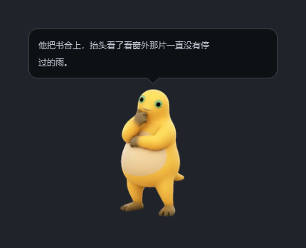
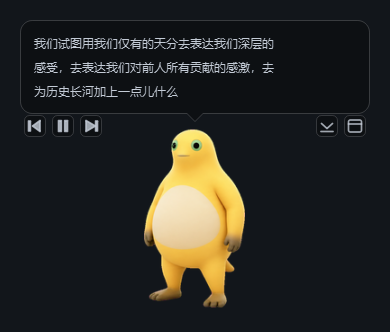
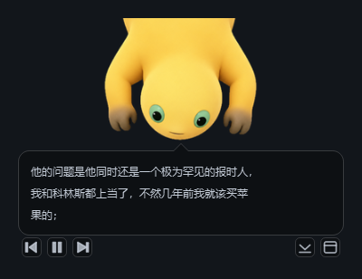

# 奶蛙阅读器 Interline

> 贴在别的窗口上的中文电子书阅读器，能压成一条、一键隐身，还有只奶蛙陪你念书。


---

## 功能

### 浮窗

- 无边框圆角，拖顶栏移动、拖右下角缩放
- 默认置顶（可关）；整窗透明度 0.15–1.0，另有底板透明度只透背景、字不变透
- 四套皮肤，`F10` 切换
- 字号 10–40px，行距、字体可改
- 一键隐身 `Ctrl+Alt+D`：全局热键，把阅读器和奶蛙一起藏
- 常驻托盘，点 × 只收起；重复启动不重复开窗口

<p align="center">
  
  
</p>

**一行模式（`F9`）**：窗口压成一条只显示当前句，**默认宽度就等于普通阅读面板**（点下一句不再变宽），可用鼠标拖右下角调整；句子比窗口长就出一条横向细滚动条，**朗读时滚动条会跟着念到的字走**。方向键 ↑/↓ 切上一句/下一句、←/→ 横向滚动，点正文 / 滚轮翻句；**朗读中滚一下滚轮即暂停**。

底部浮着一条**独立的圆角胶囊工具带**（v70 起是**面板正下方的独立浮窗**，不是叠在面板里）：上一句 / 朗读 / 下一句、章节与本章句进度、隐藏窗口 / 回主面板；**鼠标指上面板才淡入、移开淡出**，手感和奶读气泡的工具条一致；面板贴屏幕底时自动翻到上方。

<p align="center">
  
</p>

### 奶蛙陪读（`F8`）

独立悬浮窗，主窗正常看书，蛙浮在桌面念当前句。主窗和蛙分开：正文、目录、书库都在主窗，蛙只管念，拖蛙不动主窗、开书库蛙继续念。

<p align="center">
  
  
</p>

动作接真实朗读状态：

- 朗读时呼吸 + 口型，嘴随句开合
- 隔几秒随机小动作（抬手、抬头、跑两步），播完回念书
- 停下托腮不动
- 点蛙随机一个反应：八成跳一下笑一声，两成吐个舌头（配「安迪」）；点气泡开关朗读
- 滚轮 / 方向键翻句，拖动挪位，右键菜单

<p align="center">
  
</p>

**悬停工具条**：气泡旁浮出五颗按钮（上句 / 播放 / 下句 / 收气泡 / 主面板），播放键随状态变图标。悬停时还显示「第 3/12 章 · 42%」进度。

<p align="center">
  
  
</p>

**贴边形态**：拖到屏幕边缘 10px 内松手吸附，八向，斜露半边。气泡贴内侧、尾巴朝蛙。身体只眨眼 + 抬手，朗读时嘴也动。**底部（`s`）有四套躺姿——蹲着比耶、侧躺比耶、侧躺屈腿、仰躺举腿，每次吸附随机来一种**，每套都带睁眼 / 闭眼两帧。按可见像素判定（不是窗口矩形），拖出变回站立；多屏相邻边不吸，可关。

<p align="center">
  
  
</p>

- 主窗 × 只收界面，蛙继续念；要全藏用老板键
- 笑声等音效可单独关，出声时朗读压到 40%
- 蛙不抢焦点，开着也能在主窗操作
- 素材低帧率，中间帧靠图生图补

### 听书

两套引擎，设置里挑音色：

- **系统语音**（winrt 后端，离线，默认）
- **在线音色**（Edge 神经语音，更自然，需联网，失败自动回落系统语音）

按句读、读到哪句高亮哪句；选中一段可从此处开始。语速 0.8×–2.0×。在线音色按句合成缓存、预取下一句。

<p align="center">
  
</p>

### 书库与标注

- 卡片 / 列表视图，显示进度；文件丢失标灰
- 目录、全书搜索带命中数和跳转
- 全书书签，`Enter` 跳转、`Del` 删除；删书可撤销

<p align="center">
  
  
</p>

### 格式

| 格式 | 说明 |
| --- | --- |
| `.txt` `.md` `.text` `.log` / 无扩展名 | 自动识别 UTF-8 / GB18030，按 `第X章` `Chapter N` `序章` `番外` 等切章；无标记按 2 万字分块 |
| `.epub` | zipfile + ElementTree 直接读 spine，不依赖第三方解析库 |
| `.html` `.htm` `.xhtml` | 去标签后按文本处理 |
| `.pdf` | pdfminer 按版面坐标取文本，用「首行缩进」断段 |

单章超 6 万字自动再切。

## 快捷键

| 操作 | 默认键 | | 操作 | 默认键 |
| --- | --- | --- | --- | --- |
| 滚动一屏 | `Space` | | 添加书签 | `Ctrl+D` |
| 向上滚一屏 | `Shift+Space` | | 目录 | `Ctrl+T` |
| 朗读开关 | `F5` | | 搜索 | `Ctrl+F` |
| 一行模式 | `F9` | | 书库 | `Ctrl+L` |
| 奶读模式 | `F8` | | 老板键（全局） | `Ctrl+Alt+D` |
| 切换皮肤 | `F10` | | | |

头两项是正文区自带滚动、改不了；其余八项可在设置里改（右键 → 设置…），即时生效，清空恢复默认。老板键被占用会自动换候选，设置页标出实际生效的那个。

<p align="center">
  
  
</p>

## 下载即用

[Releases](/releases) 有现成的 `Interline.exe` 直接下，双击就能用。单文件绿色，不写注册表 / 启动项，退出不留日志。

数据在 `%LOCALAPPDATA%\Interline\`：

```
config.json    窗口位置、字体、皮肤、快捷键、朗读设置、奶蛙开关与位置
library.json   书库与阅读进度
marks.json     书签
tts-cache/     在线音色 MP3 缓存（按 文本+音色+语速 哈希）
```

带 U 盘走就加 `--portable`，数据存 exe 同级的 `InterlineData\`。

## 致谢

- 奶蛙精灵图：[timerring/codex-pet-naiwa](https://github.com/timerring/codex-pet-naiwa)（MIT），中间帧由图像模型在该素材上生成，同按 MIT 使用
- 在线音色：[edge-tts](https://github.com/rany2/edge-tts)（LGPL-3.0）

## License

[MIT](LICENSE)
