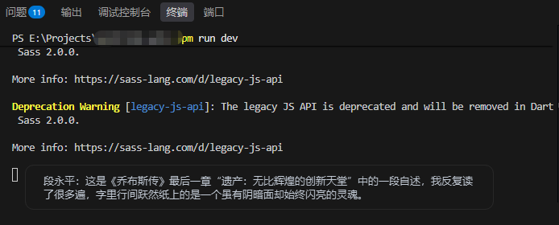
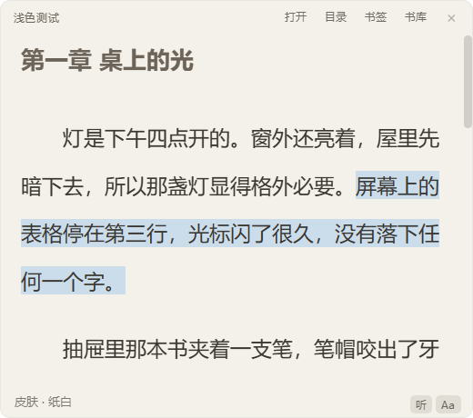
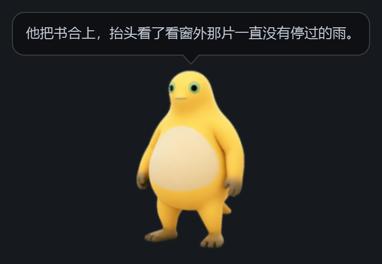
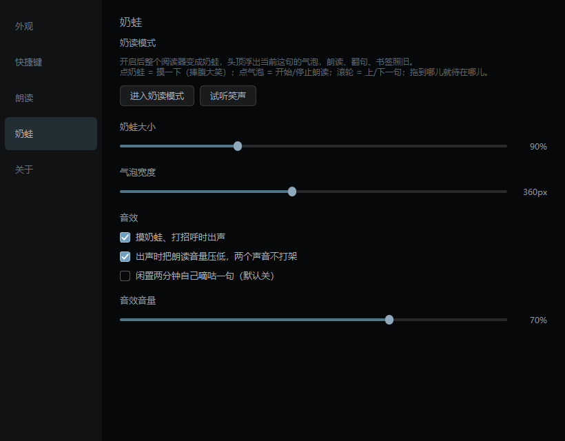
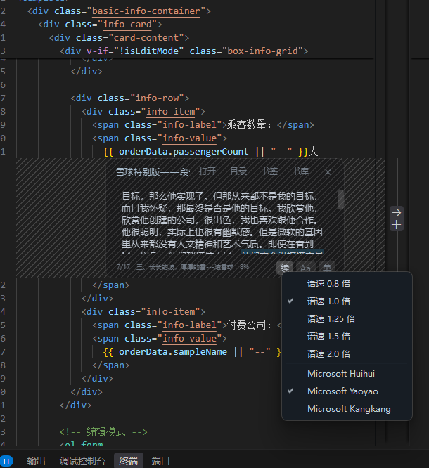
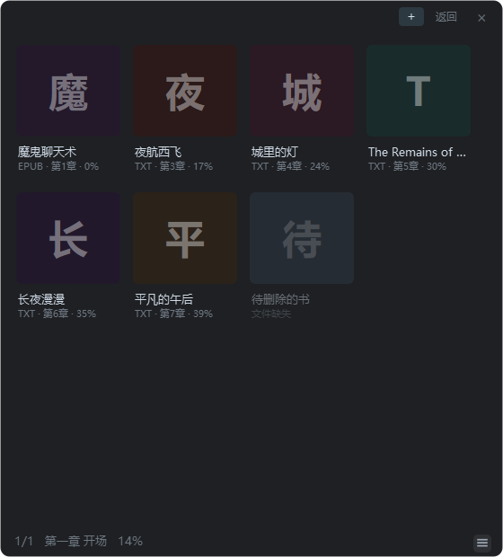
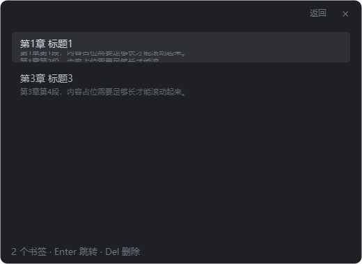
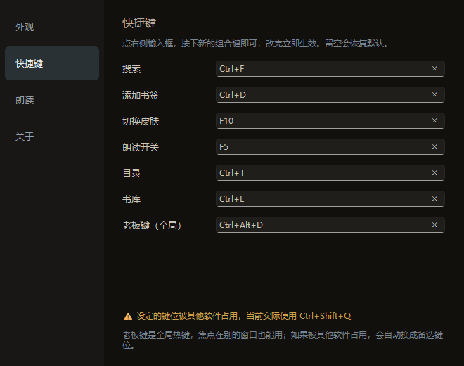

# 行间 Interline

> 贴在别的窗口上的中文电子书阅读器。半透明、置顶，能压成一条，一键就没。


---

## 为什么有这东西

主流的阅读器都想占满屏幕，书架、翻页动画、云同步、使用统计一样不少。但我打开阅读器的场合通常很窄：等构建、等回包、等会议开始，手边十分钟，读两页，不想让人看出来。

所以它只照顾这一种用法。一个不占地方的小窗口，浮在别的程序上面，透到能看见底下的代码，读完了按一下就没了。

<p align="center">
  
</p>

## 功能

**窗口**

- 无边框圆角面板，拖顶栏移动，右下角拉大小
- 默认置顶，可以关掉。整窗透明度 0.15–1.0；底板透明度是另外一项，只让背景变透，字始终是实的
- 四套皮肤：墨蓝、纯黑、暖褐、纸白，`F10` 轮换
- 字号 10–40 px，滑动条写多少屏幕上就是多少像素。行距和字体族也能调
- 常驻托盘。点 × 只是收起来，退出在托盘菜单里。重复启动不会开第二个窗口，只会把已有的叫到前面

<p align="center">
  
</p>

**一行模式（`F9`）**

整个窗口压成一条，只显示当前这句，宽度跟着字数走。顶部 8px 的窄边用来拖位置，正文区点一下就翻下一句，方向键和滚轮也行。

<p align="center">
  
</p>

**奶读模式（`F8`）**

奶蛙是一只**独立的悬浮窗**，规矩跟音乐软件的桌面歌词一样：主窗口照常看书，蛙浮在桌面上报当前这一句。

主窗该有的全都还在——正文、目录、书签、书库、设置、页码、朗读按钮。点「书库」就在主窗里正常打开书库，点「目录」就翻目录，蛙一概不参与。两个窗口各管各的：拖蛙不会动主窗，主窗最小化、换主题、开书库，蛙只是继续念它的。

九种动作接的是真状态，不是装饰：朗读时原地小跑，暂停时站着等，一句读完抬头看一眼，翻句朝对应的方向跑两步（`running-left` / `running-right`），加书签原地跳一下，读失败就愣住，闲置久了发呆。

- 点奶蛙 = 摸它一下，它会捧腹大笑并放出笑声
- 点气泡 = 开始 / 停止朗读（没开书时是去挑一本书）
- 滚轮 / 方向键 = 上一句 / 下一句，拖动 = 挪位置（拖的时候朝反方向跑，位置记在 `pet.x/y`）
- 右键 = 隐藏气泡、开始朗读、打开文件、书库、设置、收起奶蛙
- `Esc` 落在蛙身上 = 收起奶蛙；落在主窗上 = 退当前的目录 / 书库视图，两者互不牵连
- 笑声、打招呼的嘀咕、闲置时的自言自语可以单独关；出声时朗读音量自动压到 40%，不抢拍
- 主窗的 `×` 只收起阅读界面，**蛙留在桌面上接着念**（朗读本来就没停，把蛙一起藏掉等于声音还在人不见了）。要连蛙一起消失用老板键

之所以把蛙拆成独立窗口而不是让主窗「变身」：变身期间主窗的正文、目录、书库全部不可用，等于看不了书只能听；而且窗口尺寸被锁成「气泡 + 蛙」，退出时还得记住原尺寸和位置再还原。拆开之后两边都是普通窗口，谁也不欠谁——点书库不用先退出奶读，退出奶读也不会把主窗挪个位置。

蛙弹出时不抢焦点（`WA_ShowWithoutActivating`），所以开着它照样能直接在主窗里选中、搜索、滚正文。

气泡宽度、奶蛙大小、音量都在设置里调。

音效有一步预热：第一次发声要现场初始化音频端点（蓝牙耳机、眼镜这类设备还得等链路唤醒），这段延迟里写进去的样本是听不到的，听感就是「开头被切掉」。所以蛙一出现先用静音放 160 ms 把链路叫醒，200 ms 后才打招呼。设备也在构造时就绑定好——留在首次播放里 `setDevice()` 等于现建一次音频 sink，同样会吞开头。用 WASAPI 环回录音做同一探针 A/B：修复前首声比第二声晚出声 36.8 ms，修复后两次打平（差值落在 ±13 ms 的运行抖动里）。

素材本身是低帧率的：每个动作只有 4–8 张关键帧，原速播放时单帧要停 70–125 ms，看着一顿一顿。补帧分两种做法：

- **图生图补中间帧**（`make_pet_ai.py`，用于 `waiting` / `running` / `running-right` / `running-left` / `review` / `failed`）。把相邻两帧喂给图像模型，让它画「正好在两者中间」的那一帧。实测相邻帧步长降 30–36%，是唯一能把「整体不动、肢体大摆」的动作补干净的办法。
- **传统插值**（`make_pet_sheet.py` 里的质心补偿 + 交叉淡化，只用于 `idle`）。`idle` 相邻帧位移不到 1 像素，混合是干净的；换到跑动这类动作上会叠出两条腿。

`waving` 和 `jumping` 不补帧，只把播放帧率提上来。前者模型把「抬手挥动」画成「手放在嘴边」还带出喙状变形（步长只降 18%），后者源素材带白色地面投影，喂进模型后投影在白底上消失，生成的中间帧跟前后帧对不上。

图生图不是求中间值而是重画一帧，所以会顺带把不动的地方也重画（头部整段宽 5%、躯干 12%）。`make_pet_ai.py` 用逐行宽度归一化把轮廓压回两帧均值，头部误差从 4.5 px 降到 0.9 px；腿部区域不做这个校正，因为「两脚分开」和「两脚并拢」的跨度均值没有物理意义。中间帧的位置也不是完美的 50/50，实测落在 67% 附近，所以步长是「一大一小」交替，不是均匀减半。

**贴边形态**

拖到屏幕边缘吸附时，蛙改成「斜着露出半边身体、另一半压在边缘外」的姿态，**身体不动，只眨眼和抬爪**：八向 × 三相位（`base` / `blink` / `hi`）共 24 张 256×256 透明 PNG（`assets/naiwa/edges/`），**吸附逻辑还没接**。

眨眼不进任何循环：停 2–4 秒随机，闪一帧 160 ms 就回来。抬爪是交互不是循环——鼠标指针压在蛙身上才 `hi`，移开立刻回 `base`；不自己播完就放下来。判定 hover 得按 alpha 采点，窗口是 256×256，可见像素只占 14–34%，按矩形判会「隔空招手」。

不做呼吸是刻意的——顶边那张的呼吸动的是头，稍微给多一点就像在引体向上；侧姿态那 8px 躯干胀缩在 256px 上基本看不出来。想恢复把 `make_pet_edges.py` 里的 `BREATH` 打开，源图还在。

规格、命名、方向映射、播放节奏都在 [`assets/naiwa/edges/SPEC.md`](assets/naiwa/edges/SPEC.md)。核心约定只有一条：画布贴着屏幕的那条边就是切口，接入时不用记裁剪偏移，换帧也别动窗口位置。预览在 `screenshots/pet-edges.png`（八向 base）、`pet-edges-context.png`（模拟桌面贴边）、`pet-edges-frames.png`（8×3 胶片条）、`pet-edges-anim.gif`（三个方向的眨眼与抬爪）。

<p align="center">
  
  
</p>

**老板键（`Ctrl+Alt+D`）**

走 Win32 的 `RegisterHotKey`，焦点在别的程序里也能按。键位被占用会自动换候选，设置页标出实际生效的那个。小键盘上的符号键同样有效。

**听书**

两套引擎，在设置里挑一个音色：**系统语音**（Qt TextToSpeech 的 `winrt` 后端，离线可用，**默认**）或 **在线音色**（Edge 神经语音，音质更自然，需要联网）。在线音色按句合成 MP3 并缓存，播当前句时后台预取下一句；连不上时这一次自动切回系统语音，不改设置。按句读，读到哪句高亮哪句；选中一段可以直接「从这里开始读」。语速五档（0.8 倍到 2.0 倍），在「听」按钮的右键菜单或设置里调。进度精确到句。

在线音色由 [edge-tts](https://github.com/rany2/edge-tts)（LGPL-3.0）提供，走微软 Edge 的在线服务；这不是官方授权的接口，没有可用性保证，所以默认仍然是离线的系统语音。在线音色的音频走 Qt，默认跟随系统输出设备；如果系统默认是没连上的蓝牙耳机，在「设置 → 朗读 → 输出设备」里手动指定正在用的扬声器即可。

<p align="center">
  
</p>

**在线更新**

启动后比对 GitHub 的 latest Release，比当前版本新就在书名右边挂一个红色 `NEW`。点开能看到版本号、更新说明和「前往发布页」；点「更新」直接从 GitHub 下载 exe，带进度条，下载完覆盖自身并重启。右键菜单里有「检查更新」可以手动查。

下载地址就是 Release 里挂的 exe 直链，公开可读、不需要 token。国内网络慢的时候会显示下载进度，失败可以重试。

**书库与标注**

- 卡片、列表两种视图，显示全书进度（章 + 百分比）。文件不在了会标灰
- 目录、全书搜索，带命中数和上下跳转
- 全书书签。标注面板里 `Enter` 跳转，`Del` 删除
- 删书能撤销，书签一起回来

<p align="center">
  
  
</p>

**格式**

| 格式 | 说明 |
| --- | --- |
| `.txt` `.md` `.text` `.log` / 无扩展名 | 自动识别 UTF-8 / GB18030，按 `第X章` `Chapter N` `序章` `番外` 等切章；没有章节标记的按 2 万字分块 |
| `.epub` | zipfile + ElementTree 直接读 spine 顺序，不依赖第三方解析库 |
| `.html` `.htm` `.xhtml` | 去标签后按文本处理 |
| `.pdf` | pdfminer 按版面坐标取文本，用「首行缩进」断段而不是靠行尾标点 |

单章超过 6 万字会自动再切，免得单个富文本文档大到滚动发涩。

## 下载即用

如果 [Releases](/releases) 里有现成的 `Interline.exe`，下下来双击就能用。没有的话按下面「打包」自己生成，跑起来是一样的。

单文件绿色版，双击就跑。注册表和启动项都不碰，退出后也不留日志文件。

数据在 `%LOCALAPPDATA%\Interline\`：

```
config.json    窗口位置、字体、皮肤、快捷键、朗读设置、奶蛙开关与位置
library.json   书库与阅读进度
marks.json     书签
tts-cache/     在线音色的 MP3 缓存（按 文本+音色+语速 哈希）
```

想带着走就把 exe 放 U 盘，启动时加 `--portable`，数据改存到 exe 同级的 `InterlineData\`。

正常情况下这里不会出现日志。只有某个操作在 Qt 的回调里抛了异常时，会多一个 `error.log`：PyQt 默认遇到这种情况会直接 `abort()`（表现就是「点一下程序就没了」），所以程序接管了异常处理，把堆栈写进这个文件并继续运行。

## 快捷键

| 操作 | 默认键 | | 操作 | 默认键 |
| --- | --- | --- | --- | --- |
| 滚动一屏 | `Space` | | 添加书签 | `Ctrl+D` |
| 向上滚一屏 | `Shift+Space` | | 目录 | `Ctrl+T` |
| 朗读开关 | `F5` | | 搜索 | `Ctrl+F` |
| 一行模式 | `F9` | | 书库 | `Ctrl+L` |
| 奶读模式 | `F8` | | 老板键（全局） | `Ctrl+Alt+D` |
| 切换皮肤 | `F10` | | | |

头两项是正文区自带的滚动，改不了。其余八项可以在设置里改（右键菜单 → 设置…），按下新组合键即时生效，清空则恢复默认。切换章节走目录，或者把正文滚到底。

<p align="center">
  
</p>

## 代码在哪

纯 Python。除 PyQt6 外有两个依赖：`pdfminer.six`（PDF 解析）和 `edge-tts`（在线音色，只在选它时才联网）。

| 文件 | 负责 |
| --- | --- |
| `main.py` | 窗口、背景自绘、翻页与渲染主流程、听书、交互 |
| `book_parser.py` | TXT / EPUB / HTML / PDF 解析与切章 |
| `library_view.py` | 书库卡片/列表视图、目录与书签面板 |
| `settings_dialog.py` | 设置窗口（外观 / 快捷键 / 朗读 / 奶蛙 / 关于） |
| `pet.py` | 奶蛙精灵表切帧、三层动画状态机、气泡排版与绘制 |
| `pet_window.py` | 奶蛙悬浮窗（独立窗口、拖拽、滚轮翻句、右键菜单） |
| `pet_audio.py` | 奶蛙音效播放器（独立于朗读的 QMediaPlayer） |
| `assets.py` | 打包后的资源路径解析（`sys._MEIPASS`） |
| `store.py` | 三个 JSON 的读写、默认值合并、旧版字号迁移 |
| `theme.py` | 皮肤定义与浅色底下的颜色派生 |
| `speech_controller.py` | 双引擎控制器：音色选择、失败降级、停/续状态机 |
| `tts.py` | 系统语音（winrt）逐句朗读与逐词回调 |
| `edge_speech.py` | 在线音色：MP3 合成缓存、并发预取、播放与词边界 |
| `hotkey.py` | Win32 全局热键注册与原生事件过滤 |
| `logo.py` `make_icon.py` | 托盘/窗口图标绘制，生成 `icon.ico` |
| `make_pet_sheet.py` | 下载奶蛙素材、切行校对、帧间插值，生成 `sheet.png` 与 `manifest.json` |
| `make_pet_ai.py` | 构建期工具：图生图补中间帧（准备输入 / 扣底对齐 / 宽度归一化 / 镜像派生） |
| `make_pet_edges.py` | 构建期工具：贴边素材抠图、相位剪影对齐、八向摆位裁切、拼图与场景预览 |
| `Interline.spec` | PyInstaller 打包配置 |

## 从源码跑

```bash
pip install -r requirements.txt
python main.py                 # 正常启动
python main.py --selftest      # 检查 Qt / 解析层 / 奶蛙素材 / TTS 引擎是否可用
python main.py --petcheck      # 奶蛙切帧与绘制冒烟，导出一张合成图
python main.py --pdfcheck a.pdf # 只跑 PDF 解析，把结果打到临时文件
```

改奶蛙素材时：`make_pet_ai.py` 要额外装 `opencv-python` 和 `pillow`（只在构建期用，不在 `requirements.txt` 里）。重生成中间帧要调几十次图像模型，产出的 192×208 成品帧放在 `assets/naiwa/mids/`，跟着仓库走；1024×1024 的原始产物在 `build/naiwa_ai/`，不进版本库。`make_pet_sheet.py` 找不到成品帧会自动退回传统插值，不会报错。

调试时想避免污染真实配置，用环境变量把数据目录指到别处：

```bash
set INTERLINE_DATA_DIR=D:\tmp\interline
```

## 打包

```bash
pip install pyinstaller
python -m PyInstaller Interline.spec --noconfirm
```

产物是 `dist/Interline.exe`，约 65 MB。没开 UPX：单文件包本来就 deflate 过，UPX 只能再省一成左右，代价是每次启动多一层解压，还容易被杀软当成可疑程序。spec 里另外剔掉了 ffmpeg 解码后端和 `opengl32sw.dll`，合计 35 MB 上下，纯文字阅读用不到。

奶蛙的 `sheet.png`（2.9 MB）和 5 个 mp3 由 `Interline.spec` 的 `datas` 逐条列出打进包，运行时用 `assets.resource_path()` 按 `sys._MEIPASS` 找回来。`datas` 不展开通配符，加素材要手动补一行；漏了不会崩，只会退化成空窗口，所以 `--selftest` 专门有一条查素材。`assets/naiwa/mids/` 是构建期输入，不进包。

版本号只有一处：`main.py` 的 `BUILD_VERSION`，打包时由 spec 写进 exe 产品版本，运行时再从 exe 属性读回来。

## 已知限制

- **只有 Windows。** 老板键靠 Win32 的 `RegisterHotKey`，系统语音走 `winrt` 后端；在线音色本身跨平台，但整个程序换平台仍跑不起来
- **在线音色依赖非官方接口。** 可能限流或临时不可用；失败会自动回落到系统语音，但要稳定离线使用就在设置里选系统音色
- **文件改名或移动，书签会失联。** 书的 id 是路径的 hash，换个盘符就当新书了。要做「重新定位」得连带迁移 `marks` 记录
- **PDF 出来的是重排文本，不是原版版式。** 表格、多栏、图文混排的 PDF 效果很差，扫描件直接读不出字
- **一行模式只跟着句子走**，适合瞄两眼，不适合整章快读
- **奶蛙只用了 9 组动作。** 精灵图里还有两行 16 方向注视，没接——那属于「眼睛跟着鼠标转」的路子，和现在的状态机不是一套，硬接进来只会两边都不像
- **没有云同步、导出、加密。**

## 致谢

- 奶蛙精灵图：[timerring/codex-pet-naiwa](https://github.com/timerring/codex-pet-naiwa)（MIT）。`make_pet_sheet.py` 把它切成单帧入库，`jumping` 那一行自带的白色地面阴影改成了低透明度黑色，否则投在深色桌面上会发白光。`assets/naiwa/mids/` 里的中间帧由图像模型在该素材上生成，同样按 MIT 使用
- 奶蛙音效：同项目附带的 `naiwa-pet` 语音包，仅供学习交流，**请勿商用**。要发布正式版请自行替换或去掉 `assets/naiwa/sfx/`
- 在线音色：[edge-tts](https://github.com/rany2/edge-tts)（LGPL-3.0）

## License

[MIT](LICENSE)
